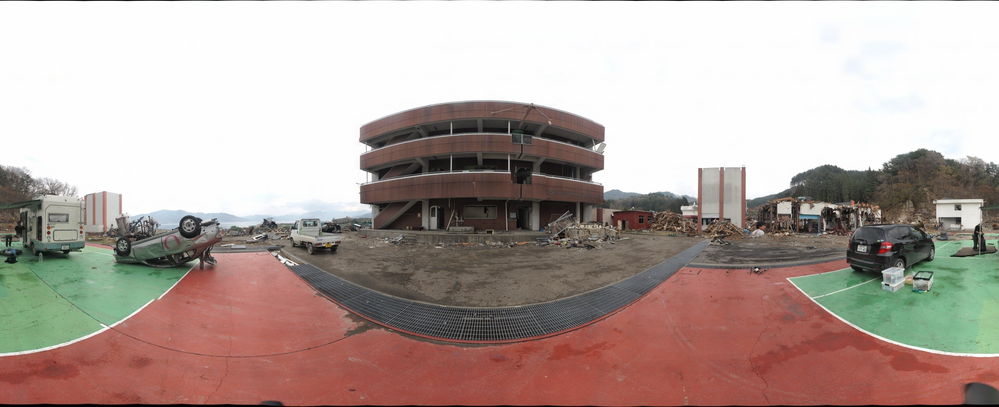

# gigapan_76649_ohtsuchi20110501akahama

東日本大震災（2011年3月11日）後の岩手県大槌町赤浜を撮影したギガピクセルパノラマ「**Akahama in Ohtsuchi**」（GigaPan ID: 76649）のアーカイブです。
GigaPan.com 上の公開データ（メタデータ・タイル画像）を取得・検証して保存しています。

- 元ページ: <https://gigapan.com/gigapans/76649>
- ビューア（このリポジトリ内）: [`docs/viewer.html`](docs/viewer.html)

## パノラマの概要

| 項目 | 内容 |
| --- | --- |
| タイトル | explore score 5 Akahama in Ohtsuchi |
| 説明 | Japan Earthquake in Ohtsuchi（大槌の震災記録） |
| 撮影者 | Taichi FURUHASHI（The Univ. of Tokyo / MAPconcierge Inc. / OpenStreetMap Foundation Japan / sinsai.info） |
| 撮影チーム | マップコンシェルジュ株式会社「GigaPanチーム」 |
| ライセンス | CC-by-SA 2.1（by Taichi） |
| 撮影日時 | 2011-05-01 09:07〜09:22（日本時間。メタデータ上は `2011-05-01T05:15:00-04:00`） |
| GigaPan 登録日 | 2011-05-05（米東部時間 23:34） |
| 最終更新 | 2018-07-10 |
| 公開状態 | 公開（`is_private: false`） |
| 閲覧数 | 2,320 回（取得時点） |
| 評価 | explore score 1.0 |
| スナップショット | 3 件（[下記](#スナップショット)） |

## 画像の仕様

| 項目 | 値 |
| --- | --- |
| サイズ | 39,616 × 16,116 px（約 6.38 億画素 / 638 メガピクセル） |
| 画角 | 水平 360°、垂直 146.4°（上 +81.8° / 下 −64.6°） |
| タイル | 256 px 角、9 レベル、総数 13,101 枚（JPEG） |
| 形式 | 全周（球面）パノラマ |

## 撮影位置

| 項目 | 値 |
| --- | --- |
| 緯度・経度 | 39.351432, 141.934837（岩手県上閉伊郡大槌町 赤浜付近） |
| 高度 | 15 m |
| 向き（heading） | 301° |
| 傾き（tilt） | 90° |
| 地図 | [OpenStreetMap](https://www.openstreetmap.org/?mlat=39.351432&mlon=141.934837#map=16/39.351432/141.934837) |

`docs/metadata/source.kml` / [`docs/gigapan_76649.kml`](docs/gigapan_76649.kml) は Google Earth 用の PhotoOverlay（球面パノラマ）です。

## 撮影・合成情報

GigaPan Stitch 1.0.0804（Macintosh）で合成しました。

| 項目 | 値 |
| --- | --- |
| カメラ | OLYMPUS E-P1 |
| 元画像 | 2560 × 1920（490 万画素）× 264 枚（22 列 × 12 行） |
| 撮影時間 | 2011-05-01 09:07:08 〜 09:22:46（約 16 分） |
| 露出 | 絞り f/13、1/30 秒（0.0333 s）、ISO 100、マニュアル露出 |
| ホワイトバランス | 固定 |
| オーバーラップ | 横 27.0〜84.3%、縦 29.8〜38.2% |
| 合成設定 | すべて既定値 |
| 合成所要時間 | 19 分 12 秒（位置合わせ 4:14 / 投影 1:53 / ブレンド 13:05） |
| 合成環境 | RAM 3840 MB、2 CPU |

## スナップショット

パノラマ内の注目箇所（切り出しビュー）です。座標は全体画像（39,616 × 16,116 px）上のピクセル位置です。

| 名前 | 説明 | 作成日 | 閲覧数 | 範囲 (x: min〜max, y: min〜max) |
| --- | --- | --- | --- | --- |
| Destroyed car（デフォルト） | 破壊された車 | 2011-05-05 | 157 | x 4,522〜8,766 / y 8,222〜11,052 |
| 半分の人（חצי בן אדם） | 同名のヘブライ語の説明 | 2011-05-10 | 259 | x 29,804〜30,525 / y 8,737〜9,217 |
| Lost Ball | 「誰かがボールを失くした、または犬が行方不明」 | 2016-04-22 | 48 | x 32,499〜33,046 / y 10,139〜10,503 |

## 関連パノラマ

同じ撮影者による大槌町などの関連作品（[`page_config.json`](docs/metadata/page_config.json) に 20 件）の例です。

- [Akahama in Ohtsuchi（76691）](https://gigapan.com/gigapans/76691)
- [Unosumai in Ohtsuchi（76709）](https://gigapan.com/gigapans/76709)
- [Near by Ohtsuchi station in Ohtsuchi（78401）](https://gigapan.com/gigapans/78401)
- [Tohno Magokoro Net in Office（79734）](https://gigapan.com/gigapans/79734)
- [Ohsawa in Yamada（80279）](https://gigapan.com/gigapans/80279)
- 宮城県・福島県・埼玉県の各パノラマ（石巻市、気仙沼市、女川町、東松島市、仙台市 ほか）

## アーカイブの取得結果

2026-10-20 に取得・検証した結果です（[`job-result.json`](job-result.json)）。

| 項目 | 値 |
| --- | --- |
| ステータス | complete（終了コード 0） |
| タイル | 期待 13,101 枚 / 検証済み 13,101 枚 / 欠落 0 枚 |
| タイル容量 | 約 159.3 MB（159,297,083 bytes） |
| 所要時間 | 約 3 分 18 秒 |

注意点:

- 公開 JSON に壊れた UTF-8 文字が含まれていたため、原本（`gigapan.json`）と文字置換した正規化版（`normalized.json`）の両方を保存しています。
- GigaPan の `options.snapshot_count` は 2 ですが、スナップショット一覧 API からは 3 件取得できました。
- サムネイル等の一部画像（`static.gigapan.com` など）は SSL ハンドシェイク失敗で取得できませんでしたが、タイル本体の検証には影響しません（[`retrieval_log.json`](docs/metadata/retrieval_log.json) 参照）。

## ディレクトリ構成

| パス | 内容 |
| --- | --- |
| [`docs/`](docs/) | 公開用ファイル一式（GitHub Pages 想定） |
| `docs/viewer.html` | タイルを使ったブラウザ用ビューア |
| `docs/preview.jpg` | プレビュー画像 |
| `docs/tiles/`, `docs/ge_tiles/` | タイル画像（通常 / Google Earth 用） |
| `docs/tile_manifest.csv` | タイル一覧 |
| `docs/gigapan_76649.kml` | Google Earth 用 KML |
| `docs/audit.json`, `docs/missing_tiles.json`, `docs/plan.json` | 検証結果・欠落タイル・取得計画 |
| `docs/metadata/` | 取得した元メタデータ（下表） |
| `gigapan_76649/` | 検証用ファイル（`audit.json`, `missing_tiles.json`） |
| `gigapan_76649.tar.gz.sha256` | アーカイブのチェックサム |
| `job-result.json` | 取得ジョブの結果 |

### `docs/metadata/` の内容

| ファイル | 内容 | 取得元 |
| --- | --- | --- |
| [`gigapan.json`](docs/metadata/gigapan.json) | パノラマ本体の情報（原本） | `gigapan.com/gigapans/76649.json` |
| [`normalized.json`](docs/metadata/normalized.json) | 上記の正規化版（文字化け修正・整形） | 加工 |
| [`source.kml`](docs/metadata/source.kml) | Google Earth 用 PhotoOverlay | `gigapan.com/gigapans/76649.kml` |
| [`page.html`](docs/metadata/page.html) | GigaPan ページの HTML | `gigapan.com/gigapans/76649` |
| [`page_config.json`](docs/metadata/page_config.json) | ビューア設定（サイズ、タイルパス、関連パノラマ） | page.html から抽出 |
| [`snapshots_page_1.json`](docs/metadata/snapshots_page_1.json) | スナップショット一覧（原本） | `.../snapshots.json?page=1&per_page=100` |
| [`snapshots_normalized.json`](docs/metadata/snapshots_normalized.json) | スナップショット一覧の正規化版 | 加工 |
| [`retrieval_log.json`](docs/metadata/retrieval_log.json) | 取得日時・URL・ETag・エラー記録 | — |

## ライセンス・クレジット

- 写真: Taichi FURUHASHI / マップコンシェルジュ株式会社 GigaPan チーム
- ライセンス: CC-by-SA 2.1（詳細は [`LICENSE`](LICENSE) を参照）
- 元データ: [GigaPan](https://gigapan.com/gigapans/76649)
